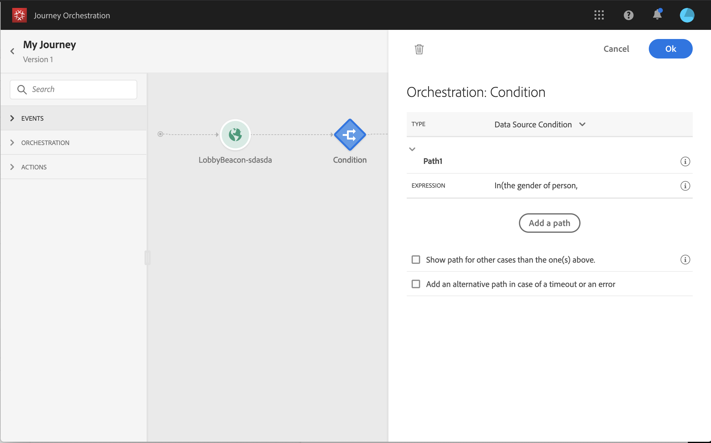

# Sobre atividades de orquestração {#concept_ksq_2rt_52b}

>[!CAUTION]
>
>**Está procurando pelo Adobe Journey Optimizer**? Clique [aqui](https://experienceleague.adobe.com/pt-br/docs/journey-optimizer/using/ajo-home){target="_blank"} para acessar a documentação do Journey Optimizer.
>
>
>_Essa documentação refere-se ao material herdado do Journey Orchestration, que foi substituído pelo Journey Optimizer. Entre em contato com a equipe de contas em caso de dúvidas sobre como acessar o Journey Orchestration ou o Journey Optimizer._

Na paleta, no lado esquerdo da tela, as seguintes atividades de orquestração estão disponíveis:

* [Atividade de condição](../building-journeys/condition-activity.md)
* [Atividade de término](../building-journeys/end-activity.md)
* [Atividade aguardar](../building-journeys/wait-activity.md)

