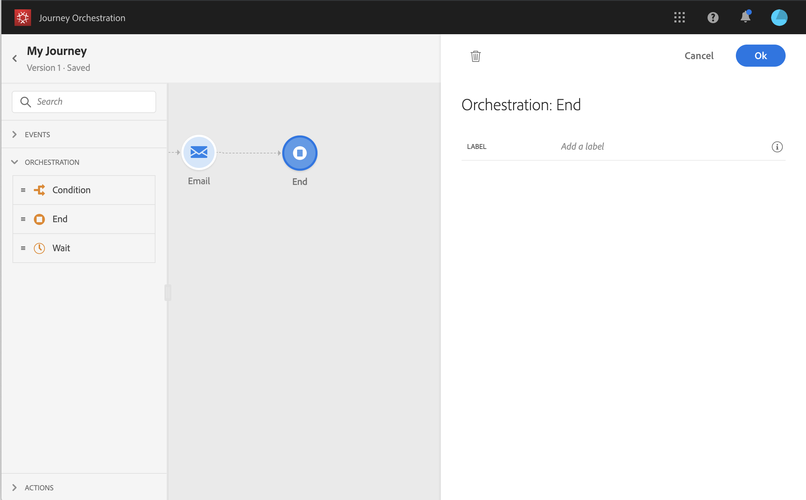

# Atividade de término{#section_vqp_4ft_dgb}

>[!CAUTION]
>
>**Está procurando pelo Adobe Journey Optimizer**? Clique [aqui](https://experienceleague.adobe.com/pt-br/docs/journey-optimizer/using/ajo-home){target="_blank"} para acessar a documentação do Journey Optimizer.
>
>
>_Essa documentação refere-se ao material herdado do Journey Orchestration, que foi substituído pelo Journey Optimizer. Entre em contato com a equipe de contas em caso de dúvidas sobre como acessar o Journey Orchestration ou o Journey Optimizer._

A atividade **[!UICONTROL End]** permite marcar o final de cada caminho da jornada. Não é obrigatório, mas recomendado para clareza visual. Na verdade, se a jornada tiver várias atividades finais, recomendamos adicionar um rótulo a cada “Fim” para facilitar a leitura dos relatórios. Consulte [esta página](../reporting/about-journey-reports.md).

